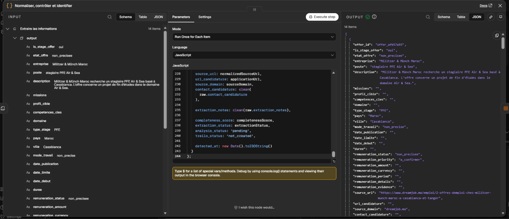
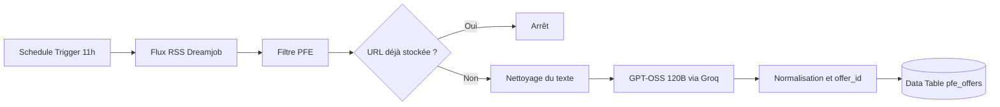

# PFE Search Engine


Pipeline local et automatisé qui détecte de nouvelles offres de stage PFE au Maroc, transforme des annonces hétérogènes en données structurées avec un LLM et évite de retraiter les mêmes URLs.

La V1 surveille le flux RSS de Dreamjob, utilise `openai/gpt-oss-120b` via Groq pour l'extraction et stocke les résultats dans une Data Table n8n.



## Problème traité

La recherche manuelle de stages exige de consulter régulièrement plusieurs sources, relire des annonces peu structurées et reporter les mêmes informations dans un tableau. Les doublons et les informations manquantes rendent ensuite la priorisation difficile.

PFE Search Engine automatise la partie répétitive :

1. découvrir les annonces candidates ;
2. écarter les URLs déjà traitées ;
3. extraire uniquement les faits explicitement présents ;
4. normaliser les champs et calculer un identifiant stable ;
5. enregistrer les résultats pour une analyse ultérieure.

Le choix d'une offre et l'envoi d'une candidature restent entièrement humains.

## Résultat vérifié

Test fonctionnel réalisé le 20 novembre 2026 :

| Étape | Résultat |
| --- | ---: |
| Entrées lues dans le flux RSS | 30 |
| Articles candidats après filtrage PFE | 14 |
| Offres extraites et normalisées | 14 |
| Offres enregistrées lors du premier passage | 14 |
| Nouveaux appels LLM lors du second passage | 0 |

Le second passage s'est terminé en quelques secondes, avant le modèle, ce qui valide la déduplication en amont et évite des appels LLM inutiles.

## Fonctionnalités de la V1

- Exécution quotidienne planifiée à 11h.
- Collecte depuis le flux RSS Dreamjob.
- Filtrage initial des contenus liés aux PFE.
- Nettoyage du HTML et réduction du texte à 12 000 caractères.
- Extraction structurée avec JSON Schema.
- Politique stricte contre l'invention d'informations.
- Extraction des dates, missions, compétences, localisation et rémunération lorsqu'elles sont explicites.
- Temporisation de 30 secondes entre les appels LLM.
- Normalisation des URLs et suppression des paramètres de suivi.
- Génération déterministe d'un `offer_id`.
- Score de complétude et statut de contrôle.
- Upsert dans une Data Table n8n.
- Démarrage automatique de n8n sous Windows.

## Architecture



La déduplication est placée avant l'appel au modèle. Cette décision réduit le coût, le temps de traitement et la consommation de tokens.

Une description détaillée est disponible dans [docs/ARCHITECTURE.md](docs/ARCHITECTURE.md).

## Structure du dépôt

```text
pfe-search-engine/
|-- assets/
|   `-- workflow-execution.png
|-- .github/
|   `-- workflows/validate.yml
|-- docs/
|   |-- ARCHITECTURE.md
|   |-- DATA_MODEL.md
|   |-- SETUP.md
|   `-- VALIDATION.md
|-- schema/
|   `-- pfe_offers.csv
|-- scripts/
|   |-- sanitize-workflow.mjs
|   `-- validate-public-workflow.mjs
|-- workflow/
|   `-- pfe-search-engine.json
|-- .gitignore
|-- package.json
|-- README.md
`-- SECURITY.md
```

## Installation rapide

Prérequis validés pour la V1 :

- Windows 10 ou 11 ;
- Node.js 24 ;
- n8n 2.48.7 ;
- un compte Groq avec accès à `openai/gpt-oss-120b`.

Étapes principales :

1. Importer [`workflow/pfe-search-engine.json`](workflow/pfe-search-engine.json) dans n8n.
2. Créer la Data Table `pfe_offers` avec [`schema/pfe_offers.csv`](schema/pfe_offers.csv).
3. Sélectionner cette table dans les deux nœuds Data Table.
4. Créer un credential Groq dans n8n et le sélectionner dans le nœud du modèle.
5. Définir le fuseau `Africa/Casablanca`.
6. Tester le workflow, puis le publier.

Vérifier l'export public avant de le versionner :

```powershell
npm run validate
```

Le guide complet se trouve dans [docs/SETUP.md](docs/SETUP.md).

## Sécurité

Le workflow publié dans ce dépôt est nettoyé :

- aucune clé API ;
- aucun credential n8n ;
- aucun identifiant de projet ou de table ;
- aucune adresse email ;
- aucune donnée issue des offres collectées.

Voir [SECURITY.md](SECURITY.md) pour la procédure de publication sûre.

## Limites actuelles

- Une seule source est active dans la V1.
- Le flux RSS fournit parfois un résumé plutôt que l'annonce complète.
- Les champs absents restent volontairement vides.
- La pertinence par rapport au profil du candidat n'est pas encore calculée.
- La machine et le processus n8n doivent être actifs à l'heure prévue.
- Le workflow ne candidate jamais et ne transmet aucun dossier à une entreprise.

## Roadmap

- Ajouter des sources marocaines complémentaires.
- Enrichir les dates et les informations de candidature depuis les pages accessibles.
- Ajouter un score de pertinence et de viabilité séparé de l'extraction factuelle.
- Générer un rapport de présélection pour validation humaine.
- Préparer des cartes Trello sans envoyer de candidature.
- Ajouter des notifications d'erreur et des tests d'évaluation du LLM.

## Auteur

**Ibrahim Moussa Mansour**

Développeur et entrepreneur, étudiant en Web Intelligence et Science des Données.
